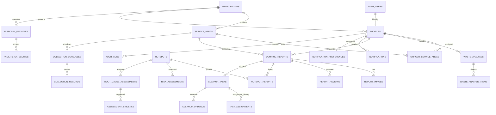

# EcoWatch AI — ER Diagram

`hotspot_reports` is the many-to-many bridge between hotspots and dumping reports. `assessment_evidence.evidence_id` is a polymorphic reference validated by trusted backend logic, as specified in the design document.
